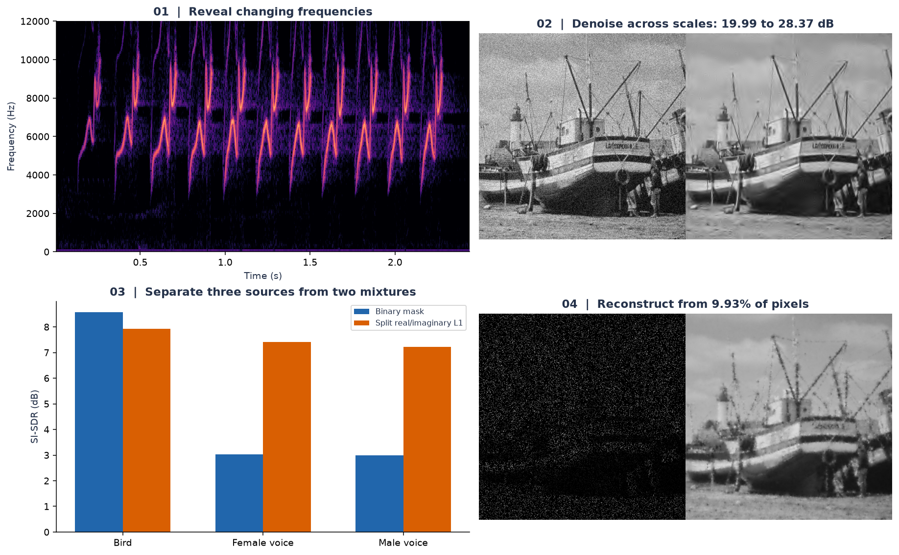

# From Signal Representations to Inverse Problems

**Analyze changing frequencies. Denoise across scales. Separate overlapping
sources. Reconstruct missing information.**

Four connected Python studies in Representation of
Signals and Inverse Problems at Centrale Lille: time-frequency analysis,
wavelet representations, sparse audio separation and image restoration.
The original boat image, bird recording and voice recordings are bundled
with the project. Every displayed result is computed from the included code.



## Explore the studies

| Study | Question | Methods |
| --- | --- | --- |
| [01 — Time-frequency analysis](notebooks/01_time_frequency_analysis.ipynb) | When do frequencies occur, and what can a window resolve? | DFT, Gaussian windows, STFT, spectrograms, original audio and two-tone file, chirps |
| [02 — Wavelet image denoising](notebooks/02_wavelet_image_denoising.ipynb) | How can multiscale sparsity distinguish structure from noise? | 1D/2D wavelets, directional subbands, DWT/SWT hard thresholding on the boat image |
| [03 — Sparse audio separation](notebooks/03_sparse_source_separation.ipynb) | Can three sources be recovered from two mixtures? | Bird and two voices, direction histograms, binary masking, split real/imaginary L1 reconstruction |
| [04 — Optimization for image restoration](notebooks/04_optimization_image_restoration.ipynb) | What can a smoothness prior recover from noise or missing pixels? | Gradient/adjoint operators, Tikhonov denoising and projected-gradient inpainting |

The notebooks explain the models, experiments and limitations. Reusable
implementations are in [`src/signal_inverse/`](src/signal_inverse/).
The checked-in notebooks contain their computed figures, tables and audio previews.

## Selected measured results

<!-- measured-results:start -->
| Experiment | Measured result |
| --- | --- |
| Wavelet denoising | Noisy input **19.99 dB** PSNR; best tested DWT **26.22 dB**; SWT **28.37 dB** |
| Three-source / two-channel separation | Mean SI-SDR: binary masking **4.86 dB**, split real/imaginary L1 **7.52 dB** |
| Inpainting | **9.93%** observed pixels; missing-pixel PSNR **24.40 dB**; observed-pixel error **0** |
<!-- measured-results:end -->

See [complete results](docs/results.md) for per-source audio scores, parameter
sweeps and the original Tikhonov baseline, including cases where it oversmooths.
The denoising grid selects parameters against the known clean image; these are
experiment results, not held-out performance estimates. Audio mixing is
instantaneous and noiseless, with a known source count and angular-sector prior.

## Run it

Python **3.12** is the tested interpreter. From the repository root:

```bash
python -m venv .venv
```

Activate with `.venv\Scripts\Activate.ps1` in PowerShell, or
`source .venv/bin/activate` on Linux/macOS. Then:

```bash
python -m pip install -r requirements-reproduce.txt
python -m pip install --no-build-isolation -e .
python scripts/run_experiments.py
python -m pytest -q
python scripts/execute_notebooks.py
python scripts/update_results_summary.py
```

The inputs are included in [`data/`](data/README.md); no separate download,
API key or GPU is needed. Figures, CSV tables, JSON summaries and WAV previews
are written to [`results/`](results/). For interactive use:

```bash
python -m pip install -e ".[notebooks,dev]"
python -m jupyterlab
```

## Scientific grounding and verification

The separation study connects sparse representations and minimum-L1 recovery
from [Bofill & Zibulevsky (2001)](https://doi.org/10.1016/S0165-1684(01)00120-7)
with spatial mixture models and time-frequency masking discussed by
[Cano et al. (2019)](https://doi.org/10.1109/MSP.2018.2874719).
The [method note](docs/source-separation.md) explains the exact connection,
the estimator's assumptions and the correction to complex-coordinate handling.

Numerical tests check STFT and wavelet reconstruction, adjoint identities,
gradients, independent linear-system solutions, real-L1 primal/dual certificates,
and preservation of observed pixels. The [verification record](docs/validation.md)
reports the executed checks; [reproducibility](docs/reproducibility.md) documents
the seeds, audio conventions and metrics.

## Project background

This project reorganizes collaborative course work into four connected
computational studies. The implementation and English explanations have been
rewritten, with shared modules, reproducible exports, numerical verification
and measured comparisons. [Provenance](docs/provenance.md) distinguishes the
original experiments from corrections and additions. Course materials credit
P.-A. Thouvenin; scientific references are listed in [REFERENCES.md](REFERENCES.md).

The focus is on understanding and implementing the numerical methods, with
experiments that make their assumptions and limitations visible.
