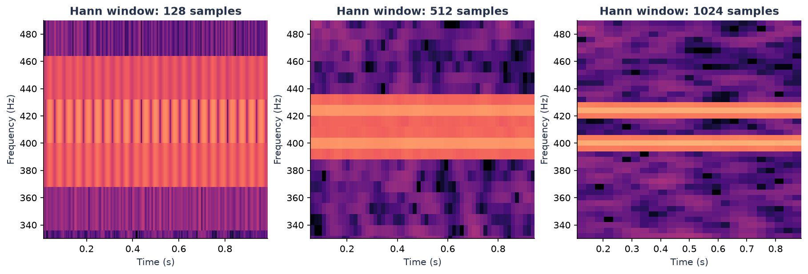
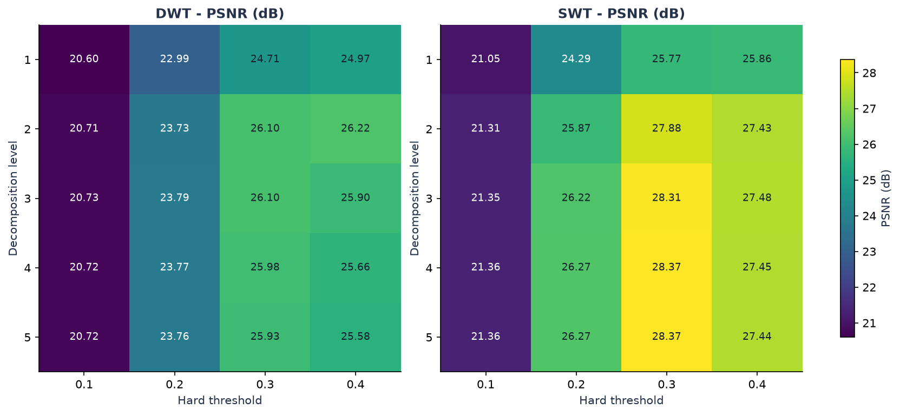
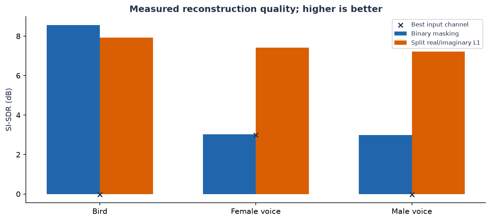
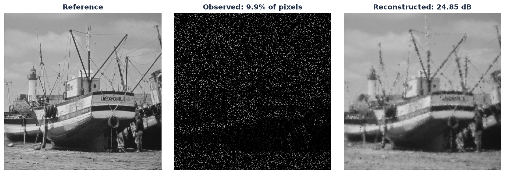

# Measured results

These values are generated from the checked-in implementation, using the original
boat image and bird/voice recordings from the course labs. They are not quoted from the original notebooks or papers.
The exact inputs, seeds and configuration are described in
[reproducibility](reproducibility.md). Each study exports its complete CSV and
JSON outputs under `results/`.

## Time-frequency analysis

The relative STFT round-trip error is
**2.124e-16**.
For the original 400/424 Hz two-tone file sampled at 4096 Hz, window lengths of 128, 512 and 1024 samples
give FFT bin spacings of 32, 8 and 4 Hz. Bin spacing is not itself a universal
frequency-resolution bound: the window's spectral shape also matters.



## Wavelet denoising

Gaussian noise uses standard deviation 0.1 and seed 1234.
The same noise realization is used for every setting. PSNR uses range one
and scores un-clipped reconstructions. This known-reference sweep chooses
among five levels and four thresholds; it is not a held-out benchmark.

| Method | PSNR (dB) | Selected level | Selected threshold |
| --- | --- | --- | --- |
| Noisy input | 19.99 | - | - |
| DWT, sym8 | 26.22 | 2 | 0.4 |
| SWT, sym8 | 28.37 | 5 | 0.3 |



The selected settings maximize PSNR only over the tested finite grid.
This does not establish an unrestricted optimum or automatic parameter rule.
SWT has higher PSNR on this particular boat image and noise realization. The result must
not be generalized to every image or noise level.

## Three sources from two mixtures

The histogram estimator is applied to the bird and voice recordings.
Its estimated directions are evaluated against the known mixing directions;
those known directions are never substituted into reconstruction.

| Source | True direction (deg) | Estimated (deg) | Absolute error (deg) |
| --- | --- | --- | --- |
| Bird | 30.00 | 28.29 | 1.71 |
| Female voice | 90.00 | 90.00 | 0.00 |
| Male voice | 150.00 | 151.71 | 1.71 |

| Reconstruction | Source | SI-SDR (dB) | Best mixture (dB) | Improvement (dB) |
| --- | --- | --- | --- | --- |
| binary | Bird | 8.57 | -0.02 | +8.59 |
| binary | Female voice | 3.02 | 2.99 | +0.03 |
| binary | Male voice | 2.99 | -0.02 | +3.01 |
| split_l1 | Bird | 7.92 | -0.02 | +7.94 |
| split_l1 | Female voice | 7.42 | 2.99 | +4.42 |
| split_l1 | Male voice | 7.21 | -0.02 | +7.23 |



Split real/imaginary L1 improves the mean score and both voice scores here;
binary masking performs better for the bird. All three sources are original
course recordings, interpreted at the original common 15 kHz analysis rate. The mean is an unweighted mean of the three per-source dB scores.

Listen to the [mixture](../results/separation/mixture_stereo.wav),
[reference source 1](../results/separation/reference_source_1.wav),
[binary reconstruction](../results/separation/binary_source_1.wav)
and [sparse reconstruction](../results/separation/split_l1_source_1.wav).
All three source tracks are exported. Preview files have separate peak gains;
the evaluation uses the arrays before playback normalization.

## Tikhonov denoising

The expected input SNR is 20 dB. The resulting noisy image has PSNR
**24.84 dB**. The original baseline (lambda=8, 100 iterations)
reaches **24.45 dB**. Changing the regularization weight
changes the balance between fidelity and smoothness:

| Regularization weight | PSNR (dB), 100 iterations |
| --- | --- |
| 0.05 | 26.30 |
| 0.2 | 28.68 |
| 1 | 29.12 |
| 8 | 24.45 |

A lower optimization objective is not a promise of better PSNR. The comparison
retains the original lambda=8 baseline even when another tested value performs
better. No reference-aware choice is advertised as an automatic deployment rule.

## Inpainting

The seed-42 binary mask observes **9.93%** of pixels.
After 300 projected-gradient iterations:

| Measurement | Value |
| --- | --- |
| Full-image PSNR | 24.85 dB |
| Missing-pixel-only PSNR | 24.40 dB |
| Maximum error on observed pixels | 0.0 |
| Tested objective histories nonincreasing | Denoising: True; inpainting: True |



The original boat image contains edges and texture that the smoothness model
can blur. These scores do not imply equivalent performance on other images. Missing fine structure
cannot be uniquely recovered from a smoothness prior alone.

## Environment

```json
{
  "numpy": "2.3.5",
  "scipy": "1.18.1",
  "matplotlib": "3.11.2",
  "PyWavelets": "1.10.0",
  "Pillow": "13.0.0",
  "python": "3.12.14"
}
```

Verification is local; no GitHub Actions workflow is included.
See [verification status](validation.md).
